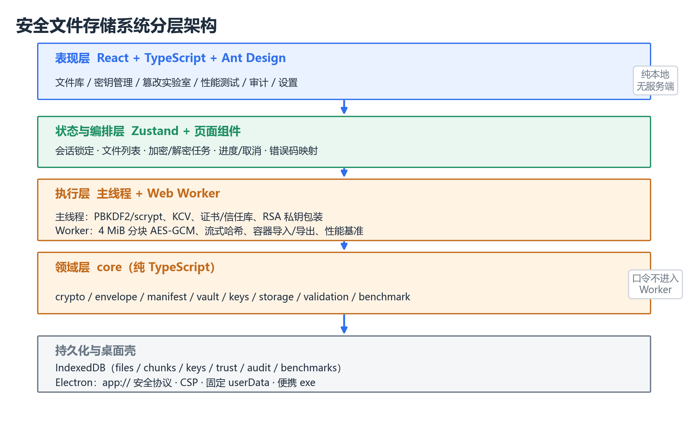
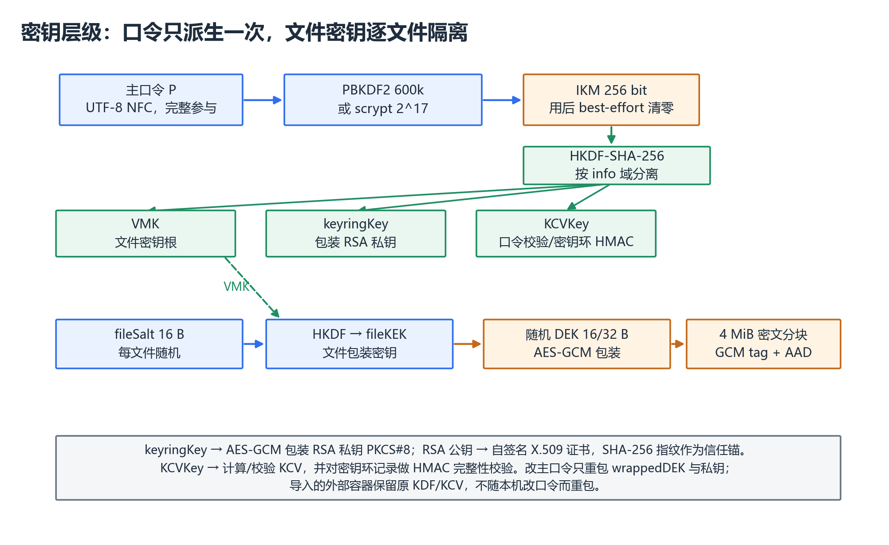
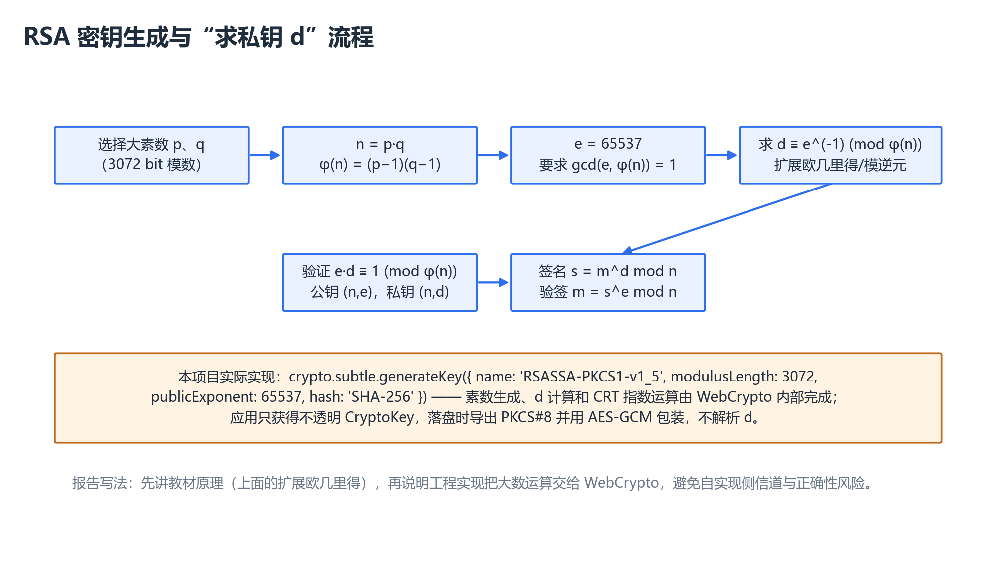
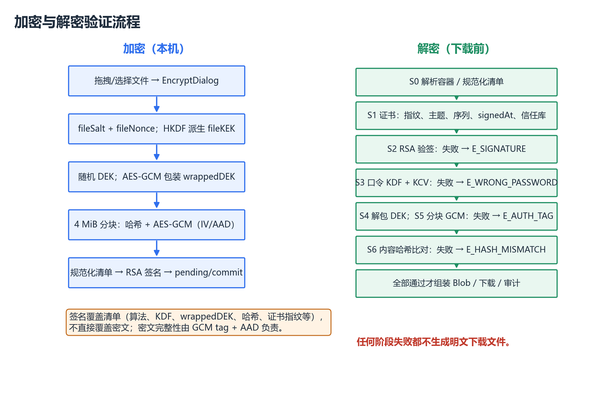
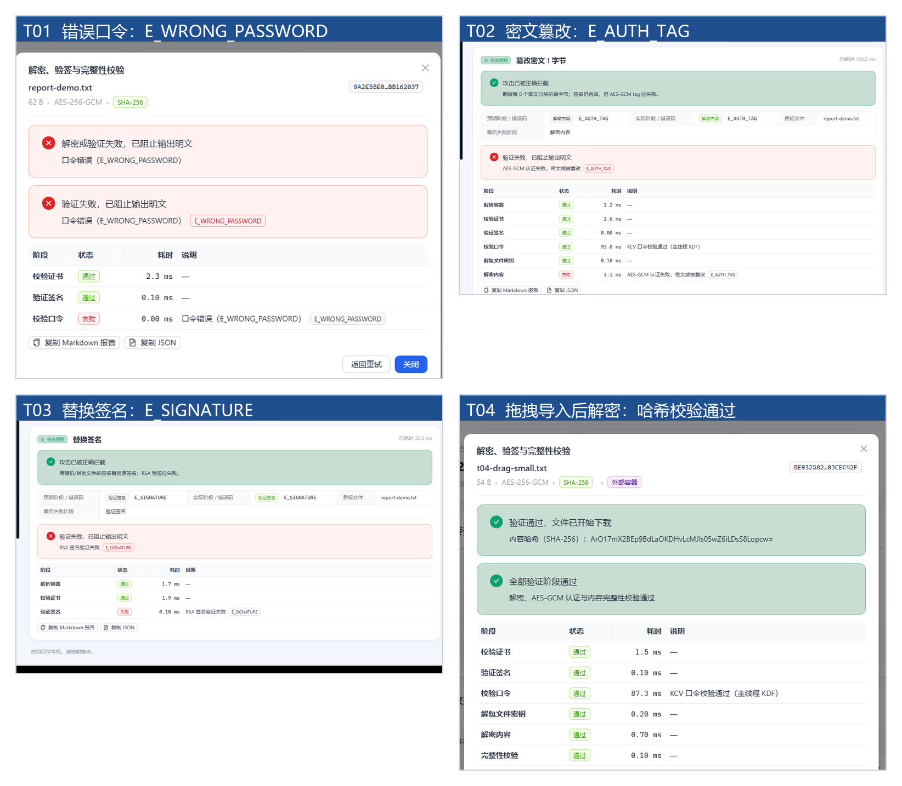

<!-- cover -->
安全文件存储系统

课程设计报告

题目3：安全文件存储系统

学院：____________________

专业：____________________

班级：____________________

姓名：____________________

学号：____________________

指导教师：____________________

日期：2026 年 10 月
<!-- /cover -->

<!-- pagebreak -->

<!-- toc -->

<!-- pagebreak -->

## 一、课题内容和要求

### 1.1 课题内容

设计一个安全文件存储系统，用户可自行选择上传数据的安全属性，支持用户对上传文件进行加密、解密操作，并可提供文件的完整性和认证性验证。

本系统面向本地文件保管场景，采用 AES-128/256-GCM 对文件分块加密，使用 SHA-256/SHA-1 计算内容哈希，主口令经 PBKDF2/scrypt 派生密钥，文件清单由 RSA-3072 私钥签名，并通过自签名 X.509 证书和 SHA-256 指纹建立信任。密文、密钥环和审计记录保存在本机 IndexedDB 中，不依赖服务端；系统同时提供浏览器版和 Electron 便携 exe，支持文件拖拽、篡改实验和性能测试。

本人负责系统总体架构、前端页面与交互、系统级测试和现场测试、性能测试、威胁模型与安全局限分析。密码学原语、密钥封装、清单签名、容器和篡改检测等核心模块由组内其他成员实现，本人负责接口集成、Worker 联调、失败路径的界面验证和测试取证。

### 1.2 课题要求

（1）支持 AES 等对称加密、SHA-256/SHA-1 哈希完整性；口令通过 PBKDF2/scrypt 等派生密钥，不能直接截断口令。本系统使用 AES-128/256-GCM 和 4 MiB 分块，PBKDF2 默认 600,000 次、scrypt 默认 N=2^17；口令按 UTF-8 NFC 规范化后完整参与 KDF。

（2）用户 RSA 公私钥对实现数字签名；下载时验签，现场篡改文件后必须验签失败。本系统使用 RSA-3072、RSASSA-PKCS1-v1_5 和 SHA-256 对规范化清单签名，前端在解密前完成证书与签名验证。

（3）密钥管理：安全存储、导出、备份、证书认证至少完成两项，并说明风险。本系统四项均实现：密钥环安全存储、`.sfkey` 加密导出、`.sfbackup` 备份/恢复、自签名 X.509 证书与指纹信任；同时说明弱口令离线破解和 TOFU 风险。

（4）现场测试：错误口令解密失败、篡改密文失败、替换签名失败、拖拽文件加解密成功。本系统用 T01–T04 四个用例记录测试结果；拖拽用于普通文件加密和 `.sfv` 容器导入，解密通过文件表/解密向导完成。

（5）报告包含威胁模型、密钥生命周期、算法参数、性能数据（大文件加解密耗时）、至少一个安全局限说明（如 SHA-1 弱碰撞性）。GUI 支持文件拖拽。上述内容在第二章和第三章分别说明。

### 1.3 本人承担的工作

本人负责总体架构与前端侧设计、前端页面和交互实现、系统级测试与现场测试、性能测试、威胁模型和安全局限分析。具体工作包括：确定分层架构和 Worker 接口边界；实现文件库、密钥管理、安全实验室、性能测试、审计和设置页面；设计 T01–T04 现场测试并整理证据；执行 1/10/100 MiB 性能测试；分析攻击者能力和系统局限。

表 1-1 小组分工（姓名、学号请按实际填写）

| 成员 | 主要工作 |
|---|---|
| 本人（【姓名】/【学号】） | 总体架构、前端页面、系统/现场测试、性能测试、威胁模型与安全局限 |
| 组员A（【姓名】/【学号】） | 密码学原语、密钥层级与封装 |
| 组员B（【姓名】/【学号】） | 清单签名、容器格式、篡改检测 |
| 组员C（【姓名】/【学号】） | 存储层、Worker、桌面打包与联调 |

<!-- pagebreak -->

## 二、需求分析和总体设计

### 2.1 本课题的主要功能包括

系统功能按模块划分如表 2-1 所示。

表 2-1 功能模块

| 模块 | 主要功能 |
|---|---|
| 保管库与密钥管理 | 创建、解锁、锁定、修改主口令；维护密钥环和会话状态 |
| 文件加密 | 拖拽/选择文件，选择 AES 算法和哈希算法，分块加密、签名、进度与取消 |
| 文件解密与验证 | 先验证书和签名，再校验口令、解密、重算哈希，失败不输出明文 |
| 拖拽与导入 | 普通文件进入加密对话框；`.sfv` 容器验签导入；`.sfbackup` 引导到密钥管理 |
| 密钥管理操作 | `.sfkey` 私钥导出、`.sfbackup` 备份/恢复、证书查看和信任库管理 |
| 安全实验室 | 错误口令、密文篡改、签名替换、证书替换等 9 类攻击演示 |
| 性能测试 | 1/10/100 MiB 的 AES、哈希、KDF、RSA 和端到端基准，结果导出 |
| 审计与设置 | 操作审计、自动锁定、默认算法、存储与安全状态；Electron 桌面版 |

**保管库与密钥管理。** 首次进入时设置显示名称和主口令，系统生成 salt、派生密钥，并生成 RSA-3072 密钥对和自签名证书；解锁后只保留运行时密钥引用，锁定或超时会清除会话。

**文件加密。** 用户可拖拽或选择多个文件，确认 AES-128/256-GCM、SHA-256/SHA-1 和 KDF 档位；系统逐文件显示进度和耗时，支持取消，失败会回滚未完成记录。

**文件解密与验证。** 解密向导先验证书和 RSA 签名，再校验口令/KCV、解包 DEK、逐块 AES-GCM 解密并比对内容哈希；任一步失败都不生成下载文件，并显示失败阶段和错误码。

**拖拽与导入。** `DropZone` 支持多文件和键盘操作并拒绝文件夹；普通文件打开加密对话框，`.sfv` 进入验签导入，`.sfbackup` 引导到密钥管理。拖拽不直接触发解密，解密从文件表或向导发起。

**密钥管理操作。** 用户可导出加密的 `.sfkey`、创建不含文件内容的 `.sfbackup` 并在新环境恢复；证书页显示自签名证书、SHA-256 指纹和信任库，首次信任需核对指纹。

**安全实验室。** 实验室在内存副本上执行篡改，展示预期/实际失败阶段和错误码，支持导出被篡改容器及 Markdown/JSON 验证报告，便于现场演示。

**性能测试。** 用户可选择 1/10/100 MiB、是否包含 scrypt 和端到端流程；测试在 Worker 中运行，以中位耗时和 MiB/s 展示，并可导出 Markdown/CSV。

**审计与设置。** 审计页记录操作、结果、阶段、错误码和文件标识，不记录口令、密钥或明文；设置页提供自动锁定、默认算法和存储状态，桌面版通过 Electron 提供便携 exe。

### 2.2 本课题的设计过程

#### 2.2.1 总体架构

系统采用“表现层—状态与编排层—执行层—领域层—持久化/桌面壳”的分层结构，如图 2-1 所示。React 页面只负责展示和交互，不直接调用 WebCrypto；Zustand 保存会话、文件列表和非敏感设置；页面组件通过 Worker 客户端提交加密、解密、导入导出和性能任务。主线程负责 PBKDF2/scrypt、KCV、证书和私钥包装，Worker 负责 4 MiB 分块 AES-GCM、流式哈希、容器解析和基准测试。口令字符串不进入 Worker，只传递解锁后的 VMK `CryptoKey`。



系统没有服务端，所有密码学操作在本机完成。浏览器版使用 IndexedDB；桌面版通过自定义 `app://secure-file-vault` 安全协议加载静态资源，并把数据目录固定在 `%APPDATA%\SecureFileVault`，避免便携 exe 解压路径变化导致数据“丢失”。

#### 2.2.2 密钥层级与生命周期

密钥层级如图 2-2 所示。主口令先做 UTF-8 NFC 规范化，再经 PBKDF2-HMAC-SHA-256 600,000 次（或 scrypt N=2^17）得到 IKM；IKM 经 HKDF-SHA-256 按不同 info 域分离为 VMK、keyringKey 和 KCVKey。每个文件生成独立 fileSalt，VMK 与 fileSalt 经 HKDF 派生 fileKEK；随机 DEK 由 fileKEK 以 AES-GCM 包装。RSA 私钥以 PKCS#8 导出后由 keyringKey 包装，公钥用于生成自签名 X.509 证书，证书 SHA-256 指纹作为信任锚。



表 2-2 密钥生命周期

| 状态 | 触发 | 密钥材料位置 |
|---|---|---|
| Created | 创建保管库，生成 RSA 密钥和证书 | 包装私钥、证书入 IndexedDB；会话解锁 |
| Active | 解锁后加密、解密、签名 | VMK、keyringKey、私钥在内存 |
| Locked | 手动锁定、自动锁定、刷新页面 | 仅包装私钥在 IndexedDB |
| Exported | 导出 `.sfkey` | 原密钥环不变，另生成加密导出文件 |
| BackedUp | 创建 `.sfbackup` | 原密钥环不变，备份含私钥/证书/信任库 |
| Restored | 从备份恢复或导入私钥 | 新保管库或替换签名密钥；旧证书保留 |
| Revoked | 从信任库移除证书 | 该证书签名的容器验证失败 |

改主口令只重新包装本地文件的 wrappedDEK 和 RSA 私钥，不重新加密文件内容；导入的外部容器保留原 KDF/KCV，仍使用容器创建时的口令。

#### 2.2.3 算法参数与容器

表 2-3 算法参数

| 项目 | 参数 |
|---|---|
| 对称加密 | AES-256-GCM（默认）/ AES-128-GCM，128 位认证标签 |
| 分块 | 4 MiB；每块独立 IV 和 AAD；单文件最多 4096 块 |
| IV / AAD | 64 位随机 fileNonce + 32 位块索引；AAD 绑定 fileId、index、chunkCount、明文长度、fileNonce |
| 内容哈希 | SHA-256（默认）/ SHA-1（仅演示）；签名摘要始终 SHA-256 |
| 口令 KDF | PBKDF2-HMAC-SHA-256 600,000 次（可选 300,000）；scrypt N=2^17 或 2^15 |
| 密钥分离 | HKDF-SHA-256，派生 VMK、keyringKey、KCVKey |
| 签名 | RSA-3072，RSASSA-PKCS1-v1_5 + SHA-256，签名 384 B |
| 证书 | 自签名 X.509，有效期 2 年，SHA-256 指纹 |
| 容器 | `SFV1` magic + 规范化 JSON 头 + 签名 + 分块密文；头 ≤ 1 MiB |
| 口令 | UTF-8 NFC，8–1024 字符，完整参与 KDF，不截断 |

容器头保存算法、KDF 参数、fileSalt、KCV、wrappedDEK、内容哈希和签名者证书等字段；RSA 签名覆盖规范化清单，不直接覆盖密文。密文完整性由 AES-GCM 的认证标签和 AAD 负责，内容哈希在解密后与签名清单比对。这样做可以同时防止算法降级、参数替换和分块重排。

#### 2.2.4 加解密与验证流程

加密时，系统为文件生成 fileId、fileSalt 和 fileNonce，派生 fileKEK 并生成、包装随机 DEK；随后按 4 MiB 分块读取文件，边算哈希边做 AES-GCM，密文分块写入 IndexedDB；全部完成后构造规范化清单、用 RSA 私钥签名，并把文件记录从 pending 提交为 committed。失败或取消会删除 pending 记录和分块。

解密时，前端编排层先调用 `verifyContainer`/`verifyStoredFile` 完成 S0 解析、S1 证书和 S2 签名验证；通过后才执行 KDF/KCV 口令校验（S3）、解包 DEK（S4）、逐块 AES-GCM 解密（S5）和内容哈希比对（S6），全部通过才生成 Blob 并下载。需要强调的是：“先验签后解密”由前端编排保证，`decryptFile` 本身从口令/KCV 开始，不负责证书信任检查。

#### 2.2.5 威胁模型

系统主要保护文件明文、主口令、RSA 私钥、VMK/DEK、密文完整性和清单/签名/证书。考虑三类主要攻击者：A1 能读取/复制 IndexedDB 和导出文件的离线攻击者；A2 能修改密文、容器头、签名或分块顺序的主动篡改者；A3 能通过 XSS、恶意扩展或已解锁浏览器读取内存的运行时攻击者。网络攻击不适用（系统无网络传输），已失陷终端、键盘记录器和内存取证不在防护范围内。

表 2-4 攻击者能拿到/不能拿到

| 攻击者 | 能拿到 | 不能拿到 |
|---|---|---|
| A1 离线存储攻击者 | AES-GCM 密文分块、wrappedDEK、fileSalt、KDF 参数/KCV、加密的 PKCS#8、证书，以及明文文件名、大小、MIME | 不能直接得到明文或私钥；若口令弱，可离线猜测 |
| A2 主动篡改者 | 可修改密文、头部字段、签名、分块顺序或截断容器 | 不能伪造受信任证书的签名；GCM/AAD 或 RSA 验签会失败 |
| A3 运行时攻击者 | 解锁期间可能读取 VMK、私钥 CryptoKey、明文和口令输入 | 系统不声称能防御已失陷浏览器/操作系统 |

信任边界是：WebCrypto 实现、解锁期设备、应用自身代码和用户当前口令可信；IndexedDB、导入的 `.sfv`/`.sfkey`/`.sfbackup`、未知证书和文件名/MIME 不可信。系统没有服务端信任边界。

#### 2.2.6 安全局限

（1）**SHA-1 弱碰撞性。** SHA-1 已被 SHAttered 实际碰撞攻破。本系统仅把 SHA-1 作为内容哈希的演示选项，默认使用 SHA-256；RSA 签名摘要始终是 SHA-256，不随内容哈希降级。但选择 SHA-1 仍会削弱内容完整性语义，实际系统应禁用。

（2）**IndexedDB 明文元数据。** 文件名、大小、MIME、创建/签名时间、算法、KDF 参数、KCV、签名者指纹等以明文保存在容器头和 IndexedDB 中。攻击者拿到存储后可以做文件类型和业务分析；系统未加密元数据。

（3）**自签名证书 + TOFU。** 没有 CA 身份背书、CRL/OCSP 吊销；首次信任依赖用户核对完整 SHA-256 指纹。用户若盲目点击“信任”，可能接受攻击者证书；真实系统需要 PKI 和证书策略。

（4）**JS 内存与删除。** 口令是 JavaScript 字符串，无法可靠擦除；CryptoKey 和明文分块可能驻留到 GC。删除 IndexedDB 记录也不等于物理擦除，审计日志在本机可被改写。系统用自动锁定和 best-effort 清零降低风险，但不能根治。

#### 2.2.7 开发与测试过程

开发按“需求与分工 → 威胁建模 → 架构与接口 → 前端实现与 Worker 联调 → 自动化/现场测试 → 打包”推进。先确定 `core` 只放密码学、React 不直接调用 WebCrypto、Worker 不接收口令等边界；再实现页面和任务编排；随后用 Vitest 验证密码学与容器逻辑，用 Playwright 验证浏览器流程、拖拽和恢复，用 Electron smoke 验证桌面壳；最后生成便携 exe，并检查数据迁移和 SmartScreen 提示。

<!-- pagebreak -->

## 三、相关功能模块详细设计

### 3.1 模块程序流程图设计

#### （一）RSA 参数与公钥生成

RSA 先选择两个大素数 p、q，计算 n=p·q 和 φ(n)=(p−1)(q−1)，选择 e=65537 并满足 gcd(e, φ(n))=1。公钥为 (n,e)，私钥为 (n,d)，其中 d 是 e 在模 φ(n) 下的乘法逆元。

#### （二）求私钥 D

求 d 的数学过程是：

> d ≡ e^(-1) (mod φ(n))，即 e·d ≡ 1 (mod φ(n))。

可以用扩展欧几里得算法求模逆元：对 e 和 φ(n) 做辗转相除，得到一组整数 x、y 使 e·x + φ(n)·y = 1，则 d = x mod φ(n)。教材小例子：p=61、q=53，n=3233，φ(n)=3120，取 e=17，可求得 d=2753，因为 17×2753=46801 ≡ 1 (mod 3120)。实际签名时计算 s=m^d mod n，验签时计算 m=s^e mod n；工程实现通常用中国剩余定理（CRT）加速。



需要特别说明：本项目**没有在 JavaScript 中手写大素数生成、扩展欧几里得或 CRT**。实际代码调用 WebCrypto：

```ts
crypto.subtle.generateKey(
  { name: 'RSASSA-PKCS1-v1_5', modulusLength: 3072,
    publicExponent: new Uint8Array([1, 0, 1]), hash: 'SHA-256' },
  true,
  ['sign', 'verify'],
);
```

素数生成、d 的计算和 CRT 指数运算由浏览器原生密码库完成；应用只得到不透明的 `CryptoKey`。需要落盘时，代码导出 PKCS#8 私钥字节并用 AES-GCM 包装，不解析 d，也不把 d 暴露给页面。这样写既符合教材原理，也符合项目的真实实现。

#### （三）加密、解密与验证流程

加密流程为：拖拽/选择文件 → 加密对话框确认算法 → Worker 生成 fileSalt/fileNonce、派生 fileKEK、包装 DEK → 4 MiB 分块哈希和 AES-GCM → 构造规范化清单并 RSA 签名 → pending 提交为 committed。解密流程为：S0 解析容器 → S1 校验证书和指纹 → S2 RSA 验签 → S3 KDF/KCV 校验口令 → S4 解包 DEK → S5 逐块 GCM 解密 → S6 内容哈希比对 → 输出 Blob；任何一步失败都不生成明文下载文件。流程如图 3-2 所示。



拖拽流程与上述不同：普通文件拖入后只是打开加密对话框，用户点击“开始加密”才执行；`.sfv` 拖入走验签导入；`.sfbackup` 提示去密钥管理；解密不在拖拽事件中触发，而是从文件表打开解密向导。因此，拖拽承担的是加密和导入入口，解密统一由文件表/解密向导发起。

### 3.2 本人负责模块的详细设计

#### 3.2.1 前端架构与拖拽交互

前端由文件库、密钥管理、安全实验室、性能测试、审计和设置等页面组成，统一使用 Ant Design 5 和中文主题。页面不直接调用 WebCrypto，而是通过 Worker 客户端提交任务、接收进度和错误；验证报告组件把每个阶段的耗时、状态和错误码展示出来，便于定位失败原因。

拖拽交互由 `DropZone` 实现：`dragenter/dragover/dragleave/drop` 维护拖拽计数和高亮状态；通过 `webkitGetAsEntry` 拒绝文件夹；从 `dataTransfer.items` 提取文件并回退到 `dataTransfer.files`；同时支持隐藏的多文件选择器和键盘操作。`VaultPage.handleFiles` 按扩展名分流：`.sfv` 逐个验签导入，`.sfbackup` 提示到密钥管理，普通文件进入 `EncryptDialog`。加密对话框支持多文件队列、算法选择、进度、取消和逐文件耗时；解密由文件表打开 `DecryptWizard`，先验证书/签名，再输入口令并下载。

#### 3.2.2 现场测试设计与结果

现场测试用例按“前置条件—操作—预期—实际—证据”记录，如表 3-1 所示。测试环境为 Windows 11、Microsoft Edge 156 headless、1440×1000 视口；测试数据均为示例文件，不使用真实密钥。

表 3-1 T01–T04 现场测试

| 编号 | 场景 | 操作 | 预期结果 | 实际结果 |
|---|---|---|---|---|
| T01 | 错误口令解密失败 | 选中文件→解密→输入错误口令 | S3 失败，`E_WRONG_PASSWORD`；不下载；报告不显示明文 | 通过，见图 3-3（T01） |
| T02 | 篡改密文失败 | 实验室→“篡改密文 1 字节”→输入正确口令→运行 | S5 失败，`E_AUTH_TAG`；不生成明文；原文件不变 | 通过，见图 3-3（T02） |
| T03 | 替换签名失败 | 实验室→“替换签名”→运行 | S2 失败，`E_SIGNATURE`；不进入口令/解密 | 通过，见图 3-3（T03） |
| T04 | 拖拽文件加解密成功 | 拖入 54 B 和 4.01 MiB 两个文件→加密→导出 `.sfv`→拖入 `.sfv` 导入→向导解密下载→SHA-256 比对 | 两个文件入库；`.sfv` 验签导入；解密成功；原/下载文件哈希一致 | 通过，见图 3-3（T04） |

T01 中，错误口令在 KCV 阶段失败，界面显示“口令错误（E_WRONG_PASSWORD）”和失败阶段，不触发 Worker 解密，因此没有明文下载。图中 password 阶段显示 0.00 ms 是失败报告的固定值，不代表 KDF 没有执行。

T02 中，实验把第 0 个密文分块首字节翻转，签名仍然有效（签名覆盖清单，不覆盖密文），但解密时 AES-GCM 认证标签失败，报 `E_AUTH_TAG`。这说明密文完整性由 GCM/AAD 保护，而不是由 RSA 签名直接保护。该测试需要输入正确的保管库口令，否则会先报 `E_WRONG_PASSWORD`。

T03 中，实验用随机字节替换 RSA 签名，证书和公钥不变；验证签名时 RSA 校验失败，报 `E_SIGNATURE`，流程在进入口令阶段前终止。替换签名不需要输入口令。

T04 使用真实 `DataTransfer` 拖入两个文件：54 B 的 `t04-drag-small.txt` 和 4.01 MiB 的 `t04-drag-large.bin`（2 个分块）。加密完成后导出小文件 `.sfv`，删除本地副本以避免“同一 fileId 已导入”的去重限制，再把 `.sfv` 拖回文件库；导入时完成证书和签名验证。随后通过解密向导分别解密导入容器和 4.01 MiB 本地文件，下载后计算 SHA-256：小文件为 `02b3b5…a5cc`，大文件为 `3a05d1…0663`，均与原始文件一致。T04 的“加解密成功”是“拖拽加密/导入 + 向导解密”，不是拖拽事件直接触发解密。



此外，安全实验室的预期矩阵还覆盖修改文件名、降级哈希、截断、交换分块、跨文件分块和证书替换等场景；这些场景由单元测试和预期矩阵验证，本次现场演示聚焦 T01–T04。证书替换界面显示失败阶段和错误码，不显示攻击者指纹。

#### 3.2.3 性能测试

性能测试使用 `artifacts/benchmark-report.md` 的完整结果，环境为 Windows 11、Edge 156 headless、16 逻辑核、16 GiB 内存、生产构建 + `vite preview`；数据集为 1/10/100 MiB 随机数据。AES/哈希取预热后 3 次中位数；PBKDF2/scrypt 各 1 次；RSA 签名/验签取 20 次中位数；端到端 1/10 MiB 取 2 次、100 MiB 取 1 次。结果如表 3-2 所示。

表 3-2 性能测试结果（节选）

| 项目 | 文件大小 | 中位耗时 | 吞吐/备注 |
|---|---:|---:|---|
| AES-256-GCM 加密 | 100 MiB | 121.7 ms | 821.7 MiB/s |
| AES-256-GCM 解密 | 100 MiB | 223.2 ms | 448.0 MiB/s |
| SHA-256 流式哈希 | 100 MiB | 765.7 ms | 130.6 MiB/s |
| PBKDF2-HMAC-SHA256 600k | — | 177.8 ms | 含 HKDF 派生 |
| scrypt N=2^17 | — | 637.2 ms | 约 128 MiB（参数推算） |
| RSA-3072 密钥生成 | — | 469.8 ms | 2 次中位数 |
| RSA-3072 签名 / 验签 | — | 6.6 / 0.10 ms | 20 次中位数 |
| 端到端加密 1 / 10 / 100 MiB | — | 25.8 / 141.5 / 1230 ms | 读取+哈希+AES+签名 |
| 端到端解密 1 / 10 / 100 MiB | — | 14.9 / 130.7 / 1160 ms | AES+内容哈希 |

结果说明：AES-GCM 原生吞吐较高，100 MiB 加密约 122 ms；SHA-256 是端到端的主要成本之一，100 MiB 约 766 ms；PBKDF2 600k 约 178 ms，适合交互式解锁；RSA 签名/验签不是瓶颈；100 MiB 端到端加密约 1.23 s、解密约 1.16 s。需要注意，端到端数字不含 IndexedDB 读写和浏览器下载，解密计时也不含证书/签名验证，且初始化使用 10,000 次 PBKDF2；实际 UI 操作会更慢。系统上限为 4 GiB/4096 块，但本次只测到 100 MiB，不能把 100 MiB 结果外推为 4 GiB 的实测结论。

## 四、部分核心代码

### 4.1 函数部分

以下代码取自当前源码，均为节选，省略了 import、日志和样式。第（一）（二）段来自本人负责的前端/测试模块；第（三）段来自组内核心验证模块，用于说明本人如何集成和验证错误口令、签名替换等失败路径。

#### （一）拖拽文件分流

```ts
// DropZone.tsx（节选）
const handleDrop = (event: DragEvent<HTMLDivElement>): void => {
  event.preventDefault();
  dragCounter.current = 0;
  setDragging(false);
  if (disabled) return;

  const items = Array.from(event.dataTransfer.items ?? []);
  const hasDirectory = items.some((item) => {
    const entry = item.webkitGetAsEntry?.();
    return entry?.isDirectory;
  });
  if (hasDirectory) {
    message.warning('暂不支持拖拽文件夹，请拖入一个或多个文件');
    return;
  }
  const files = items
    .map((item) => item.getAsFile())
    .filter((file): file is File => Boolean(file));
  emitFiles(files.length > 0 ? files : Array.from(event.dataTransfer.files));
};
```

`handleDrop` 用 `dragCounter` 处理子元素引起的 dragleave 抖动，并显式拒绝文件夹。随后 `VaultPage.handleFiles` 按扩展名把文件分成 `.sfv`、`.sfbackup` 和普通文件三类：`.sfv` 逐个验签导入，`.sfbackup` 引导到密钥管理，普通文件进入加密对话框。这样 `.sfv` 不会误进入加密流程，普通文件也不会被当作容器解析；加密要等用户点击“开始加密”后才执行，与 T04 的操作步骤一致。

#### （二）现场测试编排与预期判定

```ts
// TamperLabPage.tsx（节选）
const EXPECTED_MATRIX = [
  { kind: 'ciphertext-bit-flip', expectedStage: 'decrypt', expectedCode: 'E_AUTH_TAG' },
  { kind: 'replace-signature', expectedStage: 'signature', expectedCode: 'E_SIGNATURE' },
  { kind: 'modify-filename', expectedStage: 'signature', expectedCode: 'E_SIGNATURE' },
  { kind: 'downgrade-hash', expectedStage: 'signature', expectedCode: 'E_SIGNATURE' },
  { kind: 'truncate', expectedStage: 'parse', expectedCode: 'E_CONTAINER_PARSE' },
  { kind: 'swap-chunks', expectedStage: 'decrypt', expectedCode: 'E_AUTH_TAG' },
  { kind: 'replace-chunk-cross-file', expectedStage: 'decrypt', expectedCode: 'E_AUTH_TAG' },
  { kind: 'replace-certificate', expectedStage: 'certificate', expectedCode: 'E_CERT_UNTRUSTED' },
  { kind: 'wrong-password', expectedStage: 'password', expectedCode: 'E_WRONG_PASSWORD' },
];

const passed =
  actualStage === outcome.expectedStage && actualCode === outcome.expectedCode;
```

这段代码把“预期结果”写成可比较的数据，而不是只靠人工观察。测试运行时，实验在内存副本上调用 `tamperContainer`，再用 `verifyContainer`/解密流程得到实际阶段和错误码，最后把 `actualStage/actualCode` 与矩阵比较，并把完整验证报告展示在页面下方。这样 T02/T03 的“符合预期”有统一的判定标准，也方便扩展到证书替换等场景。

#### （三）错误口令与签名验证

```ts
// kdf.ts（节选）
export async function verifyPasswordAndUnlock(
  password: string,
  params: KdfParams,
  expectedKcv: string,
): Promise<UnlockMaterial> {
  const material = await deriveUnlockMaterial(password, params);
  if (!verifyKcv(expectedKcv, material.kcv)) {
    throw new AppError(ErrorCodes.WRONG_PASSWORD, '口令错误', { stage: 'password' });
  }
  return material;
}
```

```ts
// verifyContainer.ts（节选）
await report.run('signature', async () => {
  const valid = await verifyManifestSignature(
    source.headerBytes,
    source.signature,
    certificate.publicKey,
  );
  if (!valid) {
    throw new AppError(ErrorCodes.SIGNATURE, 'RSA 签名验证失败', {
      stage: 'signature',
    });
  }
});
```

`verifyPasswordAndUnlock` 先完成完整 KDF/HKDF，再用常数时间比较 KCV；失败时抛出 `E_WRONG_PASSWORD`，不会进入 DEK 解包。`verifyContainer` 在证书阶段之后执行 RSA 验签，失败时抛出 `E_SIGNATURE`。两段代码分别对应 T01 和 T03；本人负责把它们接入解密向导/篡改实验室，并验证失败时不会产生下载文件。

## 五、课题完成过程中遇到的问题及解决方法

**问题1：错误口令和密文篡改的失败阶段容易混淆。** 测试密文篡改时，如果输入错误口令，系统会先报 `E_WRONG_PASSWORD`，而不是预期的 `E_AUTH_TAG`。原因是验证顺序为口令（S3）在前、GCM 解密（S5）在后；密文篡改必须使用正确口令才能走到 GCM 阶段。

解决方法：在篡改实验室的口令输入框下增加“需解密至 GCM 阶段才会失败”的提示；在 T02 测试步骤中明确要求输入正确口令；在测试矩阵中记录每个用例的前置条件，避免把“口令错误”误判为“密文篡改未检测”。

**问题2：Playwright 选不到 Ant Design 的中文按钮。** 自动化测试按“关闭”查找按钮时经常失败，实际文本是“关 闭”；多个 Tab 中存在同名表单，也会导致选择器命中错误元素。

解决方法：在 `ConfigProvider` 中设置 `button={{ autoInsertSpace: false }}`；为不同表单设置唯一的 `name`；测试时把范围限定到当前激活的 Tab（`.ant-tabs-tabpane-active`）。调整后浏览器冒烟和拖拽脚本可以稳定复用。

**问题3：浏览器版和 Electron 版的数据不互通。** 浏览器使用 localhost origin，Electron 使用 `app://` origin，两者的 IndexedDB 相互独立；如果直接更换安装路径，还可能看起来像“数据丢失”。

解决方法：桌面版固定 `app://secure-file-vault` 安全协议和 `%APPDATA%\SecureFileVault` 数据目录；文档说明两套保管库独立；跨版本/跨设备迁移使用 `.sfv` 容器和 `.sfbackup` 备份，而不是复制浏览器缓存。

**问题4：便携 exe 的测试启动和构建遇到环境问题。** 测试终端设置了 `ELECTRON_RUN_AS_NODE=1`，Electron 会以 Node 模式运行并立即退出；另外，electron-builder 在 Windows 上处理 winCodeSign 时可能因符号链接权限失败。

解决方法：在 Electron 测试脚本中删除 `ELECTRON_RUN_AS_NODE`，分别用默认和临时数据目录复测；构建时设置 `signAndEditExecutable: false`，生成未签名便携 exe，并在文档中提示 SmartScreen 的“未知发布者”提示。最终便携 exe 可正常启动，约 77 MB。

**问题5：原有拖拽测试只覆盖了“拖拽加密”。** 现有 `dragdrop-smoke.mjs` 只拖入两个普通文件并检查入库，没有拖入 `.sfv`、没有解密下载、没有哈希比对，不能支撑“拖拽文件加解密成功”的完整结论。

解决方法：新增 T04 端到端脚本：拖拽两个文件（含一个 4.01 MiB 多分块文件）→ 导出 `.sfv` → 删除本地副本以避免 fileId 去重 → 拖入 `.sfv` 验签导入 → 向导解密下载 → 用 Node `crypto` 计算原始/下载文件 SHA-256 并比对。测试结果为：拖拽负责加密/导入，解密由向导完成，下载文件哈希与原始文件一致。

## 六、总结

### 6.1 完成情况

表 6-1 题目要求与完成证据

| 要求 | 实现/证据 |
|---|---|
| AES/哈希/KDF | AES-128/256-GCM、4 MiB 分块；SHA-256/SHA-1；PBKDF2 600k/scrypt 2^17；T04 多分块文件 |
| RSA/下载验签 | RSA-3072 + PKCS#1 v1.5 + SHA-256；T02 `E_AUTH_TAG`、T03 `E_SIGNATURE`；失败不出明文 |
| 密钥管理四项 | 安全存储、`.sfkey` 导出、`.sfbackup` 备份/恢复、X.509 指纹信任 |
| 现场测试 | T01–T04 全部通过；T04 小文件/4.01 MiB 文件下载哈希一致 |
| 性能数据 | 100 MiB 端到端加密 1.23 s、解密 1.16 s；AES/哈希/KDF/RSA 数据 |
| GUI/安全局限 | React + Ant Design 中文界面、拖拽/导入；SHA-1、明文元数据、TOFU、JS 内存/删除限制 |

### 6.2 本人工作与收获

本人完成了系统总体架构和前端侧设计，实现了文件库、密钥管理、安全实验室、性能测试、审计和设置页面，完成了 T01–T04 现场测试、性能测试和测试取证，并整理了威胁模型和安全局限。工作中体会最深的是：安全功能的“正常路径”只是一部分，失败路径同样需要设计——错误口令、密文篡改、签名替换必须被稳定拦截，且不能产生明文文件；测试要把前置条件、失败阶段和错误码写清楚，否则很容易把不同阶段的失败混为一谈。

### 6.3 局限与改进方向

系统满足课程要求，但不是生产级安全产品。后续可改进的方向包括：禁用 SHA-1；加密文件名、大小等元数据；引入 CA/吊销或更完整的证书策略；增加抗回滚版本号和审计哈希链；改进安全删除和流式落盘；把 RSA PKCS#1 v1.5 迁移到 RSA-PSS 或 Ed25519；为便携 exe 增加代码签名和自动更新校验。通过这些改进，系统可以在保持本地化优势的同时，进一步提高安全性和可运维性。
